# IncidentOps

### Real-Time Incident Management & Response Platform

IncidentOps is an enterprise-oriented full-stack application designed to help engineering and IT operations teams detect, manage, monitor, and resolve service incidents through a centralized, real-time platform.

It combines incident lifecycle management, automated alert ingestion, role-based access control, operational dashboards, and secure WebSocket communication.

## Live Application

- **Live Demo:** https://incident-ops-dun.vercel.app
- **Backend API:** https://incidentops-api-vaih.onrender.com
- **API Documentation:** https://incidentops-api-vaih.onrender.com/docs

> Hosted using Vercel, Render, and Supabase.
> The backend may experience cold-start delays on the free hosting tier.

---

## Application Screenshots

### Operational Dashboard

Real-time incident statistics, severity breakdown, service health,
and recent incident activity.

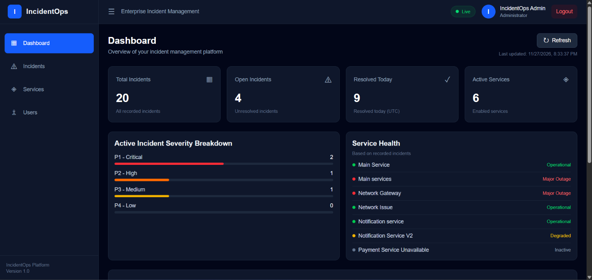

### Incident Management

Centralized incident tracking with severity classification,
lifecycle management, and real-time synchronization.

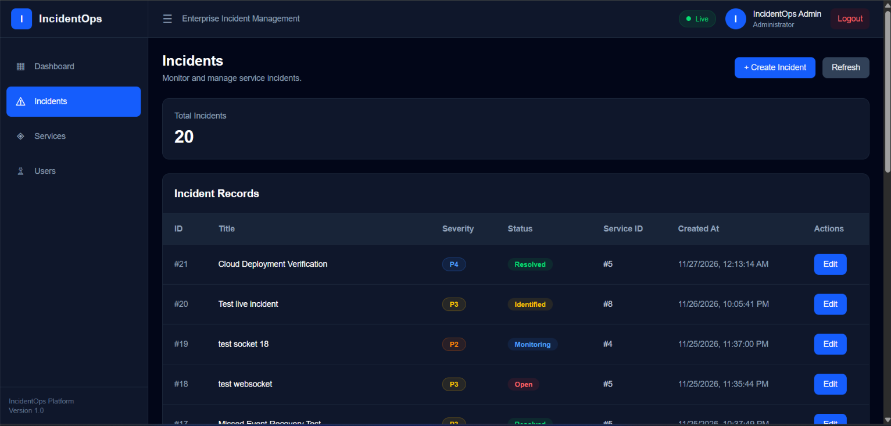

### Incident Creation and Editing

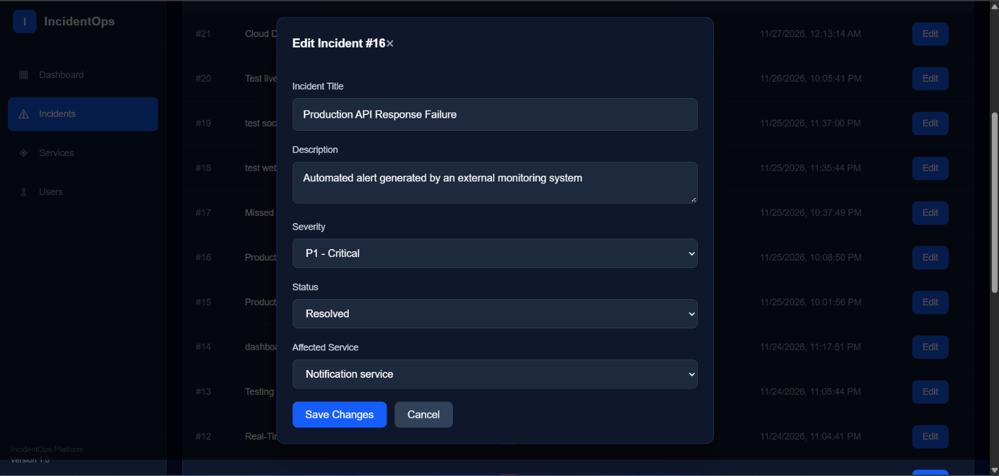

### Service Management

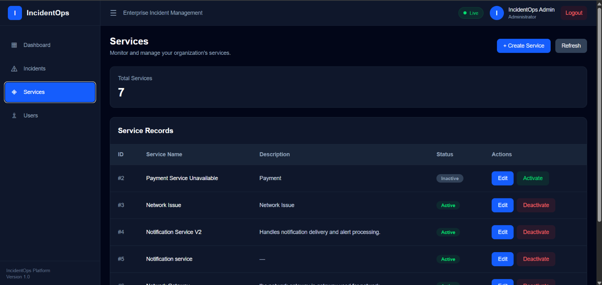

### User Management and Role-Based Access Control

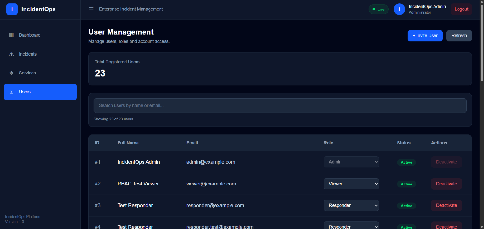

### Secure User Invitation

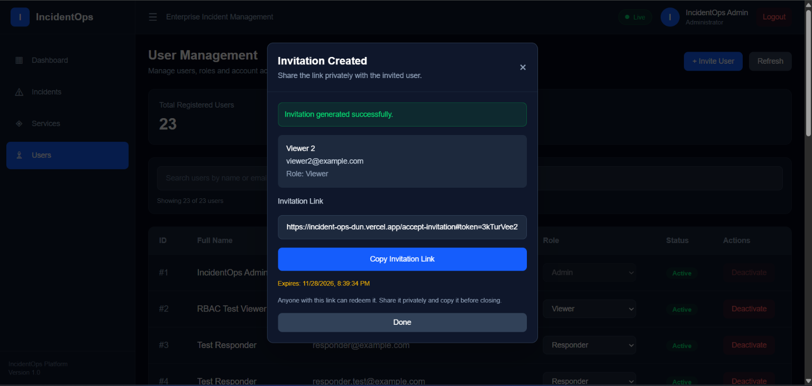

### Authentication

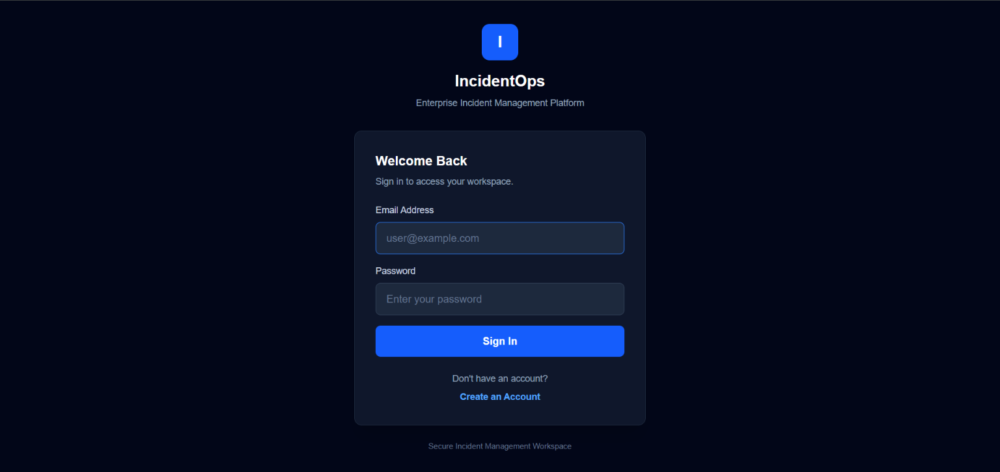

### Interactive API Documentation

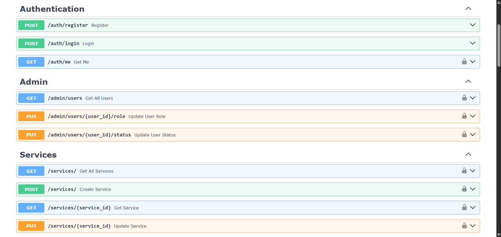

---

## Business Problem

Engineering teams often rely on disconnected monitoring tools, spreadsheets, emails, and manual communication to manage service outages.

This can result in:

- Delayed incident response
- Duplicate incident reports
- Poor visibility into service health
- Inefficient communication between teams
- Inconsistent access control
- Difficulty tracking incident resolution

IncidentOps addresses these challenges by providing a centralized platform for managing operational incidents and coordinating incident response.

---

## Key Features

### Operational Dashboard

- Live incident statistics
- Active incident severity breakdown
- Service health monitoring
- Recently reported incidents
- Daily incident resolution metrics
- Automatic dashboard synchronization

### Incident Management

- Create, view, update, and delete incidents
- P1 to P4 severity classification
- Incident assignment to responders
- Service-based incident categorization
- Incident resolution timestamp tracking
- Real-time updates across connected users

### Incident Lifecycle

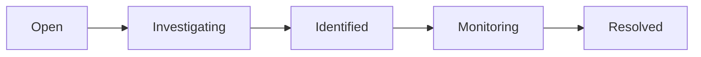

### Automated Alert Ingestion

- REST API-based webhook integration
- Webhook secret authentication
- Automatic incident creation
- Duplicate alert detection
- Alert occurrence tracking
- Transaction-safe deduplication

### Real-Time Communication

- Secure WebSocket connections
- JWT-based WebSocket authentication
- Automatic reconnection
- Exponential retry backoff
- Heartbeat monitoring
- Recovery of missed updates
- Live connection status indicator

### User and Access Management

- JWT authentication
- Public registration with restricted default permissions
- Administrator-managed user invitations
- Role-based access control
- Account activation and deactivation
- Session invalidation for inactive accounts
- Expiring, single-use invitation tokens

### Service Management

- Centralized service registry
- Service creation and modification
- Service activation and deactivation
- Incident-to-service relationships
- Dynamic service health calculation

---

## Technology Stack

| Layer | Technology |
|---|---|
| Frontend | React, JavaScript |
| Build Tool | Vite |
| Styling | Tailwind CSS |
| HTTP Client | Axios |
| Backend | Python, FastAPI |
| Database | PostgreSQL |
| ORM | SQLAlchemy |
| Database Migrations | Alembic |
| Authentication | JWT |
| Password Hashing | Argon2 |
| Authorization | Role-Based Access Control |
| Real-Time Communication | WebSocket |
| Database Hosting | Supabase |
| Backend Hosting | Render |
| Frontend Hosting | Vercel |
| Version Control | Git, GitHub |
| Code Quality | ESLint |

---

## System Architecture

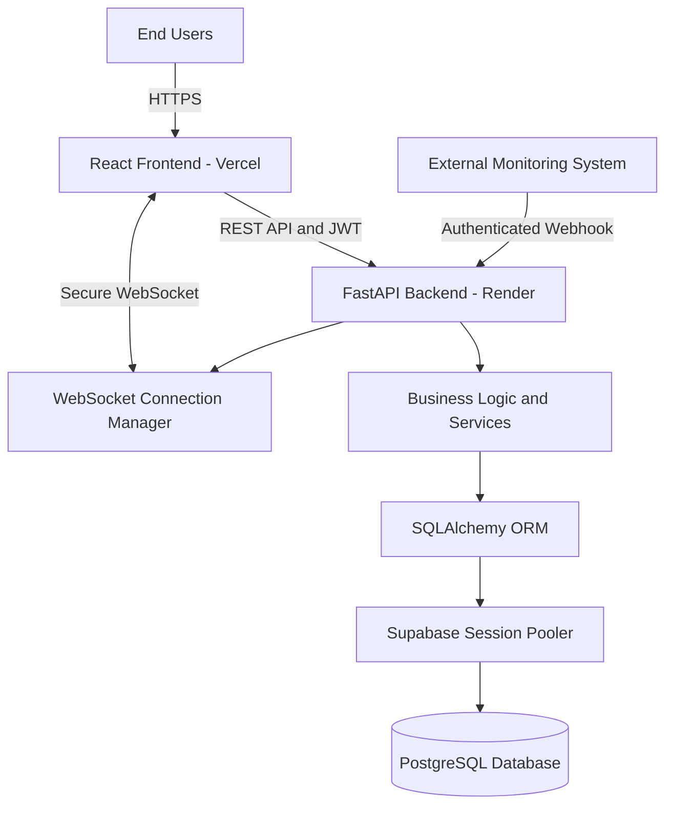

The application follows a layered architecture separating presentation, API routing, business logic, authentication, and database operations.

---

## Role-Based Access Control

| Permission | Admin | Incident Commander | Responder | Viewer |
|---|:---:|:---:|:---:|:---:|
| View Dashboard | Yes | Yes | Yes | Yes |
| View Incidents | Yes | Yes | Yes | Yes |
| View Services | Yes | Yes | Yes | Yes |
| Create Incidents | Yes | Yes | No | No |
| Update Incidents | Yes | Yes | No | No |
| Delete Incidents | Yes | No | No | No |
| Manage Services | Yes | No | No | No |
| Manage Users | Yes | No | No | No |
| Invite Users | Yes | No | No | No |
| Receive Live Updates | Yes | Yes | Yes | Yes |

Authorization is enforced at the backend API level, not solely through frontend visibility controls.

---

## Database Design

The application uses a relational PostgreSQL database.

### Core Entities

| Entity | Responsibility |
|---|---|
| Users | Authentication, roles, and account status |
| Services | Managed application and infrastructure services |
| Incidents | Incident details, severity, lifecycle, and assignment |
| Alerts | Incoming monitoring alerts and deduplication |
| User Invitations | Secure account onboarding |

### Entity Relationships

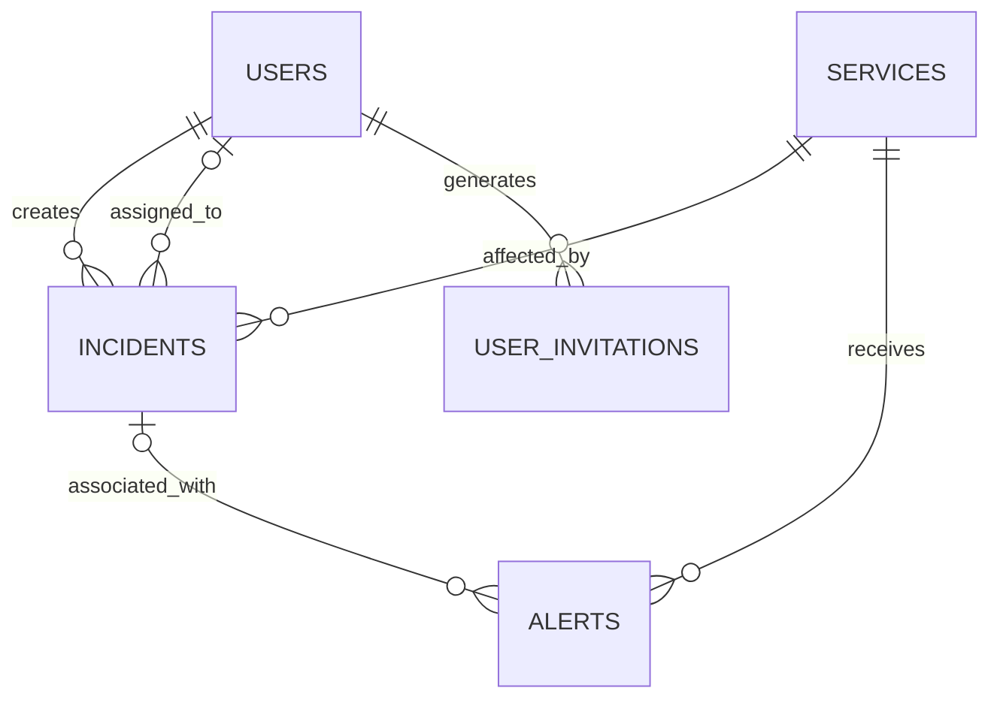

Database integrity is maintained using foreign keys, unique constraints, transactions, and schema migrations.

PostgreSQL advisory locks are used to coordinate concurrent alert deduplication and account onboarding operations.

---

## Project Structure

```text
IncidentOps/
├── backend/
│   ├── app/
│   │   ├── api/
│   │   │   └── routes/
│   │   ├── core/
│   │   ├── models/
│   │   ├── schemas/
│   │   ├── services/
│   │   └── main.py
│   ├── alembic/
│   ├── tests/
│   ├── alembic.ini
│   ├── requirements.txt
│   └── .env.example
├── frontend/
│   ├── src/
│   │   ├── assets/
│   │   ├── components/
│   │   ├── context/
│   │   ├── layouts/
│   │   ├── pages/
│   │   └── services/
│   ├── package.json
│   ├── package-lock.json
│   ├── vite.config.js
│   ├── vercel.json
│   └── .env.example
├── docs/
├── .gitignore
└── README.md
```

---

## Getting Started

### Prerequisites

- Python 3.12
- Node.js 22
- npm
- Git
- PostgreSQL database or Supabase project

### Clone the Repository

```bash
git clone https://github.com/Rakz361/IncidentOps.git
cd IncidentOps
```

### Backend Setup

```powershell
cd backend

py -3.12 -m venv venv

.\venv\Scripts\Activate.ps1

python -m pip install -r requirements.txt
```

Create a `.env` file using `.env.example` as a reference.

```env
DATABASE_URL=your_postgresql_connection_string
SECRET_KEY=your_secure_random_secret
WEBHOOK_SECRET=your_secure_webhook_secret
ALGORITHM=HS256
ACCESS_TOKEN_EXPIRE_MINUTES=30
FRONTEND_URL=http://localhost:5173
```

Use a PostgreSQL connection string compatible with SQLAlchemy and psycopg.

Apply database migrations to a new database:

```bash
alembic upgrade head
```

For Supabase deployments, review the database security configuration in the `docs` directory before exposing the application.

Start the backend:

```bash
python -m uvicorn app.main:app --reload
```

Backend API:

http://localhost:8000

Swagger documentation:

http://localhost:8000/docs

### Frontend Setup

Open a separate terminal from the project root:

```bash
cd frontend
npm ci
```

Create a `.env` file:

```env
VITE_API_URL=http://localhost:8000
```

Start the frontend:

```bash
npm run dev
```

Frontend application:

http://localhost:5173


### Initial Administrator Setup

Public registration creates accounts with the `viewer` role by default.

For a fresh installation:

1. Complete the backend and frontend setup.
2. Register an account through the application's registration page.
3. Open the PostgreSQL SQL editor or Supabase SQL Editor using an authorized database administrator account.
4. Promote the newly registered account using the following SQL statement:

```sql
UPDATE users
SET role = 'admin'
WHERE email = 'your-admin-email@example.com';
```

Replace the example email address with your registered email address.

Verify the account:

```sql
SELECT id, full_name, email, role, is_active
FROM users
WHERE email = 'your-admin-email@example.com';
```

Log out and log in again to access administrator functionality.

This is a one-time bootstrap procedure for a fresh installation.

Subsequent users can be managed through the administrator's
Users page using the built-in role management and invitation features.

Never expose database administrator credentials or privileged
account passwords in the repository.


### Production Build

```bash
npm run lint
npm run build
npm run preview
```

---

## API Overview

| Method | Endpoint | Description |
|---|---|---|
| GET | /health | Application health |
| GET | /health/database | Database connectivity |
| POST | /auth/register | Register a viewer account |
| POST | /auth/login | Authenticate user |
| GET | /auth/me | Current user details |
| GET | /dashboard/stats | Operational statistics |
| GET | /incidents/ | List incidents |
| POST | /incidents/ | Create incident |
| GET | /incidents/{id} | Retrieve incident |
| PUT | /incidents/{id} | Update incident |
| DELETE | /incidents/{id} | Delete incident |
| GET | /services/ | List services |
| GET | /admin/users | List users |
| PATCH | /admin/users/{id}/role | Update user role |
| PATCH | /admin/users/{id}/status | Update account status |
| POST | /admin/invitations | Generate invitation |
| POST | /invitations/verify | Verify invitation |
| POST | /invitations/accept | Accept invitation |
| WS | /ws/incidents | Real-time incident events |

Refer to Swagger documentation for the complete API specification, webhook endpoint, request schemas, and response formats.

---

## Security Implementation

IncidentOps incorporates multiple application security controls:

- JWT-based authentication
- Argon2 password hashing
- Backend-enforced role-based permissions
- Restricted CORS configuration
- HTTPS and secure WebSocket transport
- WebSocket origin validation
- Periodic WebSocket session validation
- Webhook secret authentication
- Hashed, expiring invitation tokens
- Single-use invitation enforcement
- Environment-based secret management
- PostgreSQL Row Level Security configuration
- Restricted database access for public API roles
- TLS-enabled production database connectivity

Sensitive credentials are excluded from version control.

---

## Testing and Verification

The following workflows have been tested during development and cloud deployment:

- Authentication and session restoration
- Role-based API authorization
- Incident lifecycle management
- Service management
- User management
- Dashboard statistics
- Multi-user real-time synchronization
- WebSocket authentication and reconnection
- Alert ingestion and deduplication
- Invitation creation and acceptance
- Concurrent registration and invitation operations
- Account deactivation and session invalidation
- Production API and database connectivity
- Frontend linting and production builds

Automated concurrency tests are available in the backend tests directory.

---

## Deployment

| Component | Platform |
|---|---|
| Frontend | Vercel |
| Backend | Render |
| Database | Supabase PostgreSQL |

The production backend connects to PostgreSQL through the Supabase Session Pooler, providing IPv4-compatible connectivity.

Frontend and backend configuration is managed using environment variables.

---

## Engineering Challenges Addressed

- Synchronizing application state across multiple users
- Preventing duplicate incidents from repeated alerts
- Handling concurrent account registration and invitation requests
- Enforcing role-based permissions at the API layer
- Maintaining WebSocket connectivity during network interruptions
- Recovering missed updates after reconnection
- Preserving incident resolution timestamps
- Managing secure configuration across deployment environments
- Resolving IPv6 database connectivity issues during cloud deployment

---

## Current Limitations

IncidentOps is an enterprise-oriented portfolio project, not a fully audited enterprise production service.

- WebSocket broadcasting currently uses a single backend worker.
- Free-tier hosting may introduce cold-start delays.
- Public registration does not verify email ownership.
- Invitation links are generated for manual sharing.
- Comprehensive rate limiting and security auditing remain future work.
- Alert-linked incident deletion requires additional lifecycle handling.

Only synthetic demonstration data should be used in the public deployment.

---

## Future Enhancements

- Email notification and invitation delivery
- Incident activity timelines and audit logs
- Incident comments and team collaboration
- SLA tracking and escalation policies
- Advanced operational analytics
- Redis-backed distributed WebSocket broadcasting
- Email verification and enhanced account security
- Automated CI/CD testing pipelines
- Optional AI-assisted incident summarization
- Multi-tenant organization support

---

## Author

**Rakesh P**

Software Engineer | Full-Stack Application Development

GitHub: https://github.com/Rakz361

---

IncidentOps demonstrates the practical application of full-stack engineering, relational database design, real-time communication, authentication, concurrency management, and cloud deployment to a real-world IT operations problem.
